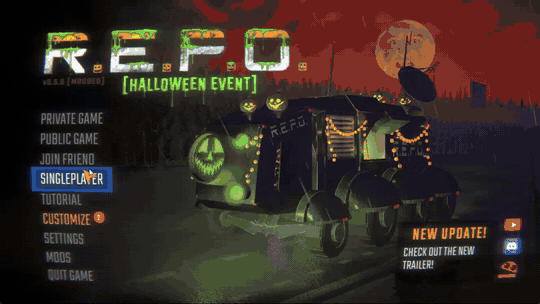

# Start With Random Weapon
Start every run in **R.E.P.O.** with one or more random weapons — fully configurable. Only the host needs to have this mod installed.

## Preview



## Features
- Start each new game owning one or several random weapons.
- Choose exactly which weapons can appear: melee weapons, guns, staffs and the weapon carts.
- Defaults follow the shop price: weapons that cost up to $20K are on, pricier ones start off.
- Give one weapon per player, or a fixed number of weapons.
- Two switches in the in-game config menu: restore every weapon to its default, or turn them all off to pick your own.
- Compatible with multiplayer — only the host needs to have this mod installed.
- Weapons behave exactly as if you bought them from the shop.
- Weapons your game version does not have (for example newer ones on an older version) are skipped automatically.

## Requirements
- [BepInEx Pack for R.E.P.O.](https://thunderstore.io/c/repo/p/BepInEx/BepInExPack/)

## Installation
1. Install [BepInEx Pack](https://thunderstore.io/c/repo/p/BepInEx/BepInExPack/).
2. Place the file `StartWithRandomWeapon.dll` into your `BepInEx/plugins` folder (or install it with your mod manager).
3. Launch the game — the configuration file will be generated automatically inside `BepInEx/config`.

## How to Use
1. Start a new run as the host — the weapons are added automatically when the run begins.
2. To change which weapons can appear, open the mod's settings from the in-game mods menu or edit the `.cfg` file.
3. Changes take effect when the next run starts; no restart is needed.

## Configuration
The configuration file is located at:
```
BepInEx/config/com.osmarbriones.startwithrandomweapon.cfg
```

### [General]
- **Enabled**
  Turn the whole mod on or off without uninstalling it. Default: `true`.

- **WeaponsToSpawn**
  Number of weapons to spawn at start (ignored if `SpawnOnePerPlayer` is true).
  Value range: **1–50**

- **SpawnOnePerPlayer**
  If true, the mod gives **exactly one random weapon per player**, regardless of `WeaponsToSpawn`.

- **ResetWeaponsToDefault**
  Set to true to restore every weapon toggle to its default value. The switch turns itself off afterwards.

- **DisableAllWeapons**
  Set to true to turn every weapon toggle off, so you can enable only the ones you want. The switch turns itself off afterwards.

### [Weapons]
Each weapon has a Boolean toggle that determines whether it can appear.

Example:
```
Item Melee Frying Pan = true
Item Gun Laser = false
Item Rubber Duck = true
```

- Set a value to `true` → this weapon is allowed to spawn.
- Set to `false` → this weapon will never appear.

| Enabled by default (up to $20K) | Disabled by default ($22K and up) |
|---|---|
| Rubber Duck, Melee Inflatable Hammer, Melee Frying Pan, Melee Sword, Melee Whip, Gun Shockwave, Gun Stun, Gun Tranq, Gun Handgun, Staff Zero Gravity | Melee Stun Baton, Melee Baseball Bat, Melee Sledge Hammer, Gun Revolver, Gun Laser, Gun Shotgun, Staff Torque, Staff Void, Cart Cannon, Cart Laser |

Defaults apply only to settings that do not exist yet. If you already have a config file, your choices are kept; use `ResetWeaponsToDefault` to apply the new defaults.

## Issues & Bug Reports
If something doesn't work, feel free to send an email to **osmarbriones@outlook.com** and I'll do my best to fix it, or open an issue on the [GitHub repository](https://github.com/OsmarBriones/StartWithRandomWeapon/issues).

## Credits
Developed by **Osmar Briones**
